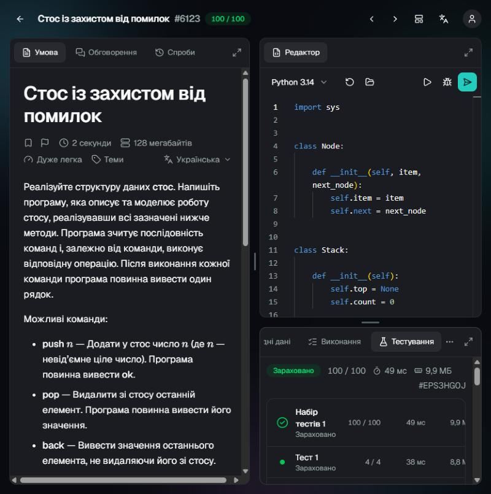
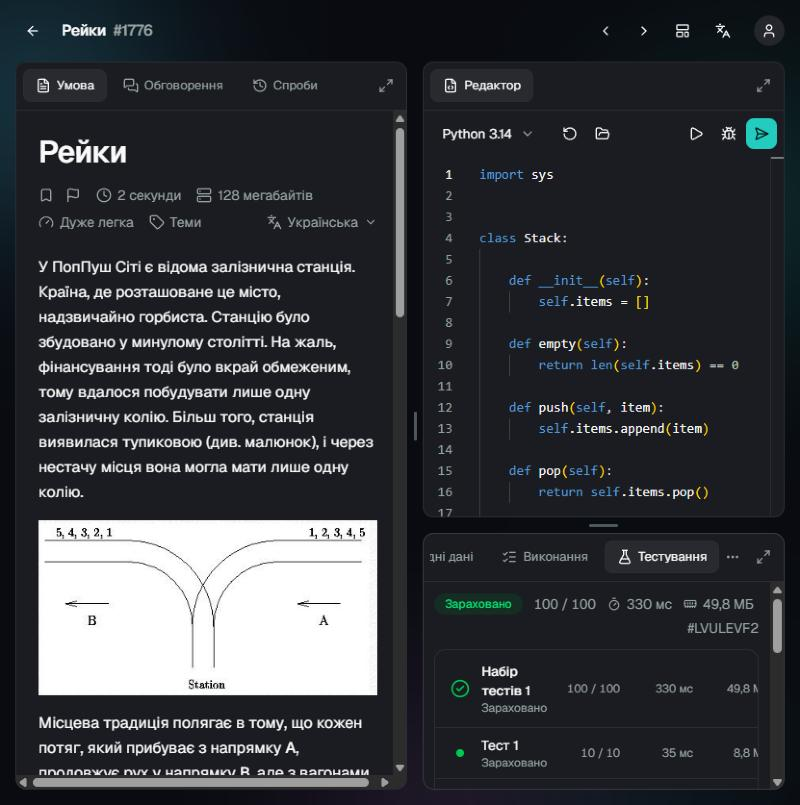
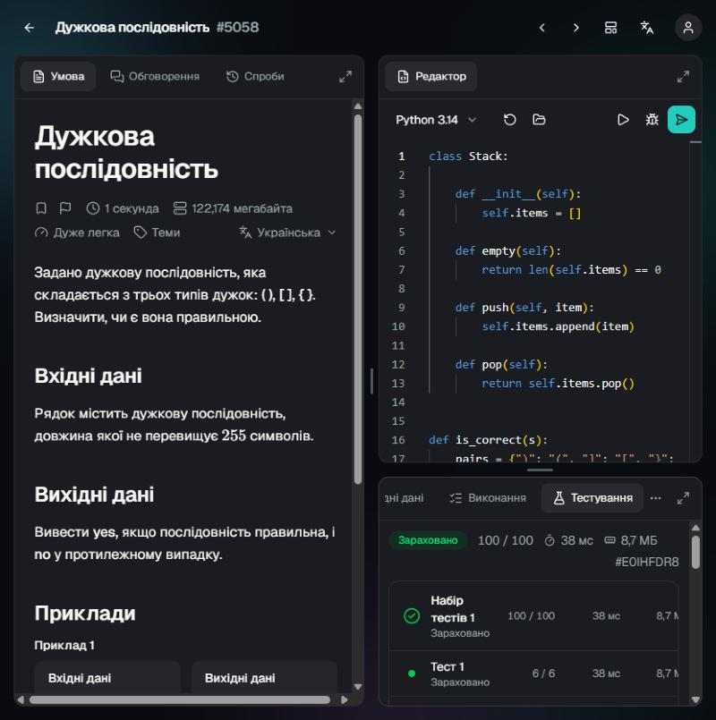
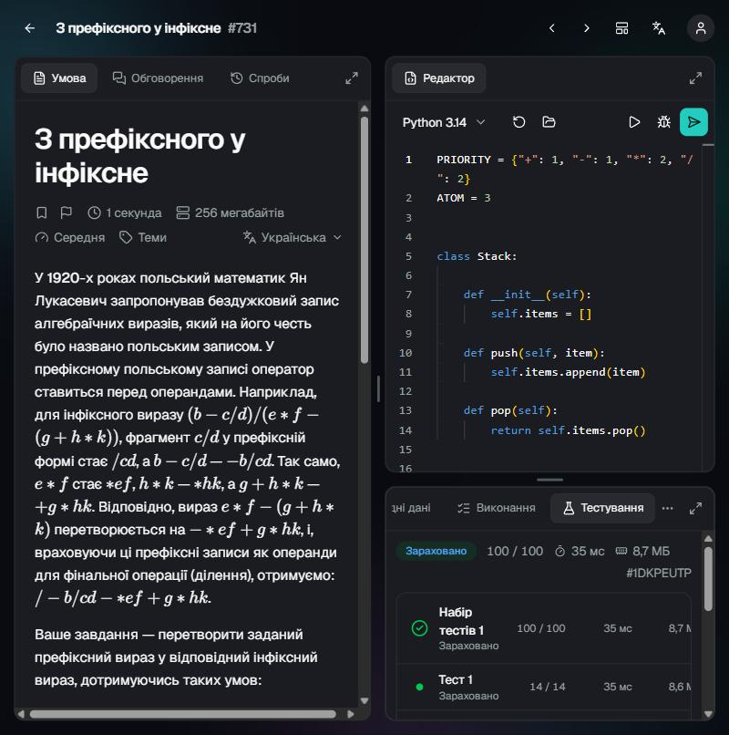

# Алгоритми і структури даних. Лабораторні роботи 12–13. Стек

У кожній задачі використано стек. У задачі 12.3 стек реалізовано як рекурсивну структуру (вузол зберігає елемент і посилання на наступний вузол).

| Задача | Eolymp | Код | Результат |
|---|---|---|---|
| 12.3. Стек із захистом від помилок | [6123](https://eolymp.com/uk/problems/6123) | [t12_03_e6123.py](t12_03_e6123.py) | 100% |
| 12.4. Рейки | [1776](https://eolymp.com/uk/problems/1776) | [t12_04_e1776.py](t12_04_e1776.py) | 100% |
| 13.5. Дужкова послідовність | [5058](https://eolymp.com/uk/problems/5058) | [t13_05_e5058.py](t13_05_e5058.py) | 100% |
| 13.6. З префіксного у інфіксне | [731](https://eolymp.com/uk/problems/731) | [t13_06_e731.py](t13_06_e731.py) | 100% |

---

## 12.3. Стек із захистом від помилок
Стек — рекурсивна структура: кожен вузол `Node` містить значення і посилання на наступний вузол, вершина стеку — перший вузол. Операції push, pop, back, size, clear виконуються за O(1); pop і back на порожньому стеку виводять `error`.

## 12.4. Рейки
Моделюємо станцію стеком. Вагони 1, 2, …, n по черзі заїжджають на станцію, доки на вершині стеку не опиниться потрібний вагон; тоді він виїжджає в напрямку B. Якщо потрібного вагона немає на вершині, а всі вагони вже заїхали — перестановка неможлива.

## 13.5. Дужкова послідовність
Відкриваючі дужки кладемо в стек. Для закриваючої дужки знімаємо елемент зі стеку і перевіряємо, що він відповідного типу. Послідовність правильна, якщо після обробки стек порожній.

## 13.6. З префіксного у інфіксне
Читаємо вираз справа наліво. Операнд кладемо в стек; для оператора знімаємо два вирази і з'єднуємо їх. У стеку зберігаємо разом з виразом пріоритет його останньої операції, щоб ставити дужки лише там, де без них зміниться зміст: лівий операнд — якщо його пріоритет нижчий, правий — якщо нижчий або рівний для операцій `-` і `/`.

